# Theme Studio

台铃（ThinkRide / Tailg）仪表主题的**桌面编辑器**，用 [MyGo](https://github.com/egoist/mygo) 的原生 UI 写成：一个 Go 二进制、Direct3D 11 绘制、不需要 WebView。

在桌面上打开官方主题包，实时预览 1024×600 仪表，替换图片、调整控件位置、改 `config.ini`，最后重新打包成可以直接在手机 App 里上传的 zip。

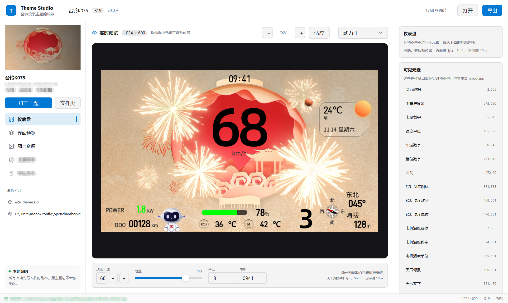

## 功能

- **打开三种来源**：外层主题 zip（`config.ini` + `package.zip`）、单独的 `package.zip`、解压后的主题文件夹；也支持拖文件到窗口。
- **1024×600 实时预览**：背景、车速数字、档位、P 档、时间、SOC 进度条/数字、骑行数据、功率、天气/日期、指南针、海拔、ECU/电机温度、氮气状态。动力模式 1–4 各用一张背景，可以随时切换。
- **12 个界面场景 + 动画**：场景下拉按「仪表 / 菜单 / 消息 / 助手 / 车机 / 主题」分组，包含仪表驾驶、主菜单、车辆设置、**菜单页面 (49 页)**、**弹窗 (7 类)**、bot 助手、充电、锁屏密码、投屏导航、自检/告警灯、主题换肤、关机倒计时。支持播放/暂停、0.25–3× 速度和中文/English 菜单切换；右侧不再重复场景列表。
- **仪表氮气状态**：读取 `layout.ini` 的 `n2_icon_0` / `n2_left_warn_0`，灰色未就绪、橙色已就绪、红色加速中，加速时播放 30 帧火焰环；右侧可切自动演示或固定三种状态。
- **ECU / 电机温度**：读取 `btn_ecu_icon/temp/unit` 和 `btn_motor_icon/temp/unit`，图标样式从 `dashboard/style/nightime/style.rc` 解析，数字使用 `dashboard/style/num`；右侧可调两个温度值。
- **仪表附加 HUD**：天气图标/文字/气温/日期/星期、指南针方向/角度、海拔、POWER 功率、ODO/TRIP/平均速度/骑行时间轮播、低电量图标、GPS 信号、4 条骑行提示、ADAS 左/右/后警告和仪表内充电浮窗；都可从右侧「仪表附加」切换或调值。
- **烟花/粒子背景**：读取 `dashboard/etc/dynamic-load.ini` 的 `particle_stat` / `particle_path`，播放主题里的 `night.mp4`（静音循环），仪表 HUD 叠在视频上；动力 1 播放视频，动力 2/3 回退静态背景，可在「仪表附加」关闭。
- **自检 / 告警灯图库**：仪表盘 tab 直接列出 18 盏警示灯 + 4 个状态灯 + GPS 的缩略图，点选后可替换/还原；开关「在预览中显示全部」会把它们按 `light.ini` 坐标叠在仪表上。灯图目录从 `light.ini` 的 `stateDir` / `signalDir` 读取，`{id}.png` 与 `{id}(1).png` 等帧自动选非透明的一张，不写死具体文件。
- **全部菜单布局**：通用渲染器遍历 `menu/etc/layout` 的 49 个二级布局（车辆设置 13 子页、DVR 11 页、导航、照片、TPMS 等），带页面选择、上一页/下一页，背景、按钮、嵌套窗口、列表和二维码都从主题 rc/layout 解析。
- **横向选项页**：ABS、TCS、日/夜模式、骑行模式、维护、时间等 `768×218`、`parent_relative` 页面改为横向选项条，标题居中、选中项用主题红色选中图，不再套二级菜单深色卡片。
- **父子窗口**：`car_set/set/*` 继承 `car_set/CarSet` 的窗口原点，`dvr/set/*` 继承 `dvr/set`；嵌套窗口按父窗口坐标递归偏移；`time` 的日期/时间编辑子窗、`maintain` 的保养信息按 layout 层次绘制；隐藏的备用窗口（保存确认、加载页等）默认不叠加。
- **菜单页专项适配**：`dash_set` 用主题的卡片图标做 5 张横向轮播；TPMS 画真实前后轮/电机图、胎压/胎温数字，并可切正常/异常；蓝牙导航画动态转向图标、车道箭头、距离和道路名，图标/箭头/车道/底图可调；蓝牙/Wi-Fi 连接页用语言对应的整页背景；ASR 弹窗播放 38 帧语音波形；DTC 按 9/39/40/41/44/71 切换故障图标。
- **全部弹窗**：蓝牙消息、来电、DTC、ASR、壁纸提示、胎压警告、清除小计里程，以及已有的充电和关机倒计时。
- **bot 助手**：解析 `bot/etc/bot_rules.ini`，在仪表、菜单、投屏场景按实际坐标显示 116×90 机器人；独立场景可切换 init / normal / menu / msg 四套各 50 帧动画。
- **直接改布局**：点选画面里的元素后拖动，或方向键 1px / Shift + 方向键 10px 微调。导出时只把 `x` / `y` 写回 `dashboard/etc/layout.ini`，宽高、样式和脚本逻辑不动。
- **图片资源库（两层分类）**：1768 张图按「仪表 / 菜单 / 锁屏 / 主题换肤 / 其他」→ 背景、速度与档位、数字与时间、导航、充电、锁屏数字等二级分类浏览，带数量、面包屑、缩略图、当前分类搜索、选中预览；支持替换单张、用文件夹按同名批量覆盖、还原原图。背景图会自动裁切填满 1024×600。
- **自适应网格**：列数按窗口可用宽度计算，放不下的卡片换到下一行，不会在右边被截断；卡片副标题只显示所属目录，完整路径在右侧检查器里。
- **主题信息编辑**：显示名、ThemeName、ThemeID、ThemeVer、ThemeType、ThemeConf、StartVersion、PackName、ResourcePath、作者、简介。
- **导出检查**：ThemeType / StartVersion 是否填写、背景是否 1024×600、速度数字是否齐全、布局是否存在，并提示跨车型风险。
- **自动重算打包字段**：`PackSize`、`FileSize`、`FileCount`、`Md5`、`BuildDate` / `BuildTime`，生成 `config.ini + package.zip` 的外层 zip；可选版本号 +1。
- **原包只读**：打开时复制到临时目录，所有编辑都在副本上；导出写新文件，绝不修改你打开的那个主题包。
- **最近打开、窗口尺寸、缩放和动力模式会记住**。

| 图片资源 | 主题信息 |
|---|---|
| 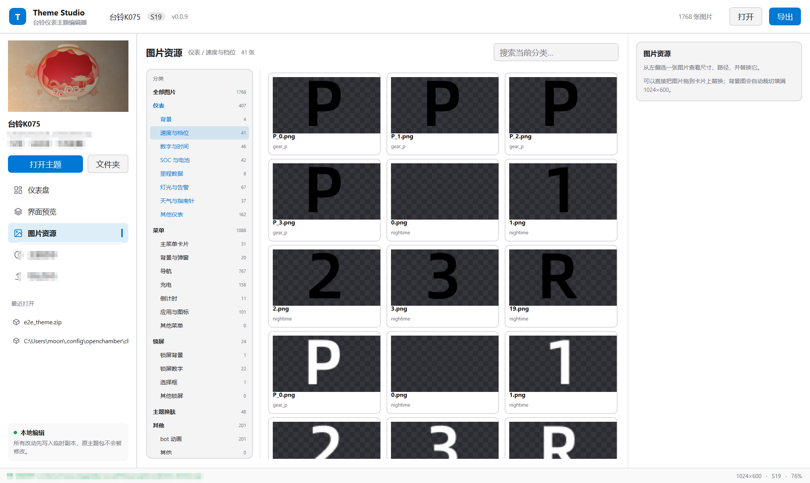 | 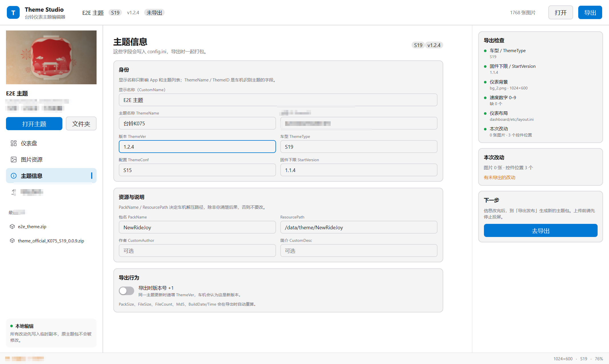 |

| 选中元素 / 调整位置 | 导出发布 |
|---|---|
| 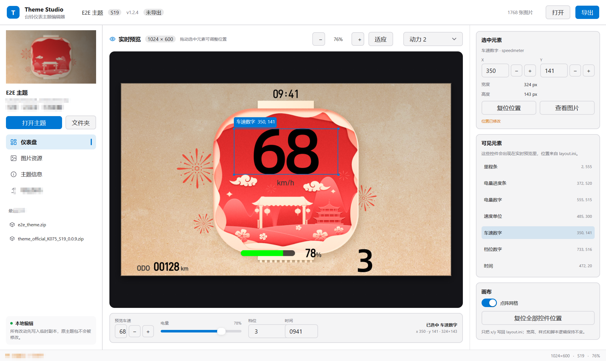 | 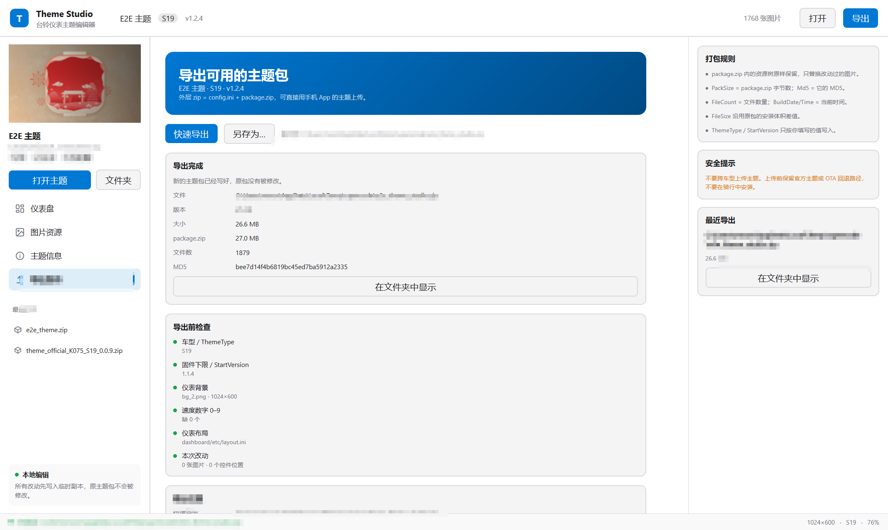 |

仪表背景的 4 个动力模式也可以在检查器里直接切换和替换：[背景编辑](docs/background.png)。

### 界面场景

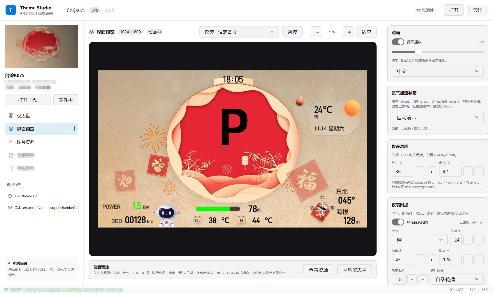

| 场景 | 模拟内容 |
|---|---|
| 仪表驾驶 | 烟花/红包粒子视频背景、车速、档位、SOC、时间；骑行数据/功率/天气/日期/指南针/海拔；氮气三态 + 火焰环；ECU / 电机温度；低电量、GPS、提示消息、ADAS、充电浮窗 |
| 主菜单 | 纵向 dock、10 个灯笼菜单卡片、自动滚动与选中框；bot 使用 menu 状态 |
| 车辆设置 | 二级菜单面板、翻译后的选项、红色选中条轮换 |
| 菜单页面 | 49 个菜单布局通用预览：页面选择、上一页/下一页、列表/卡片/二维码 |
| 弹窗 | 7 类消息/来电/故障/语音/警告弹窗，带滑入动画 |
| bot 助手 | 116×90 序列帧：初始化 / 待机 / 菜单 / 消息，大尺寸舞台预览 |
| 充电 | `menu/style/charge` 的百分比、电池/线缆/闪电 48 帧序列 |
| 锁屏密码 | 5 位密码逐格输入、选中框跟随光标 |
| 投屏导航 | `dashboard/style/link` 背景、底部车速/SOC/档位、时间；右下角 bot |
| 自检/告警灯 | 18 盏警示灯 + 4 个状态灯 + GPS 信号；全部点亮自检，然后按组闪烁；暂停时显示整套 |
| 主题换肤 | `switch_theme` 的 48 帧 Loading 动画 |
| 关机倒计时 | 3–2–1 大数字、下电提示和进度条 |

氮气三态：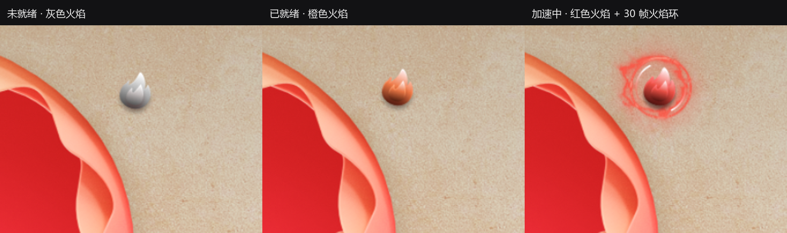

仪表盘 tab 的告警灯图库：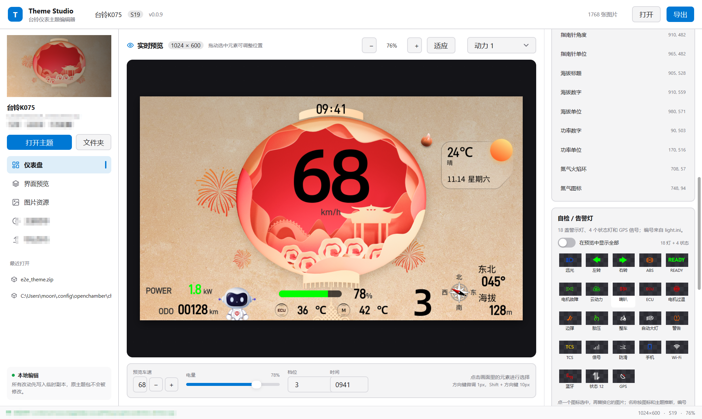

ECU / 电机温度：

菜单专项：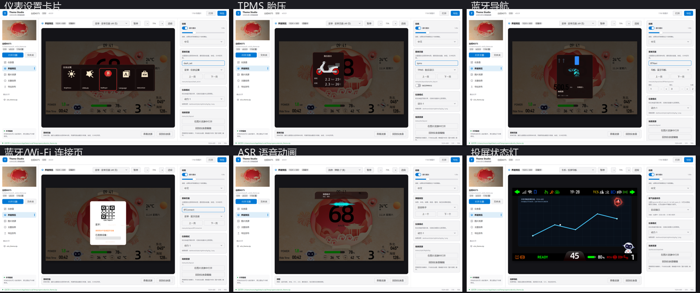

| 充电界面 | 自检 / 告警灯 |
|---|---|
| 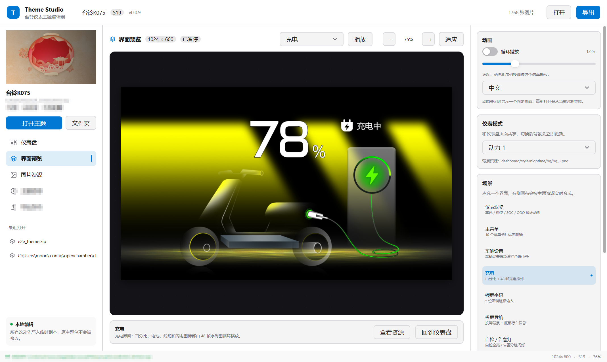 | 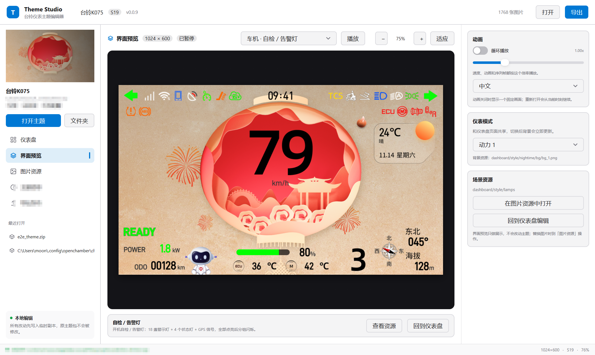 |

| 菜单页面 | 弹窗 |
|---|---|
| 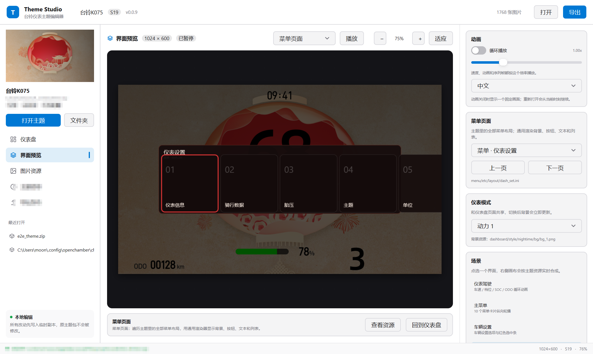 | 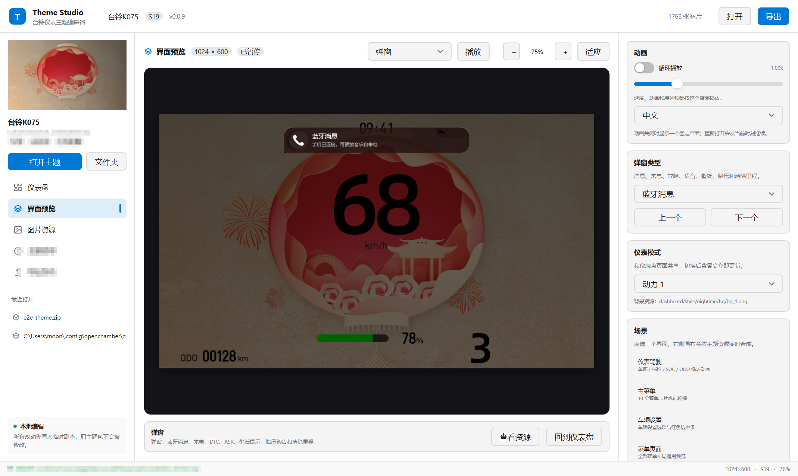 |

bot 独立预览：[bot 助手](docs/bot.png)。

## 主题包结构

编辑器按官方主题的目录工作：

```text
NewRideJoy/
├─ dashboard/
│  ├─ etc/
│  │  ├─ layout.ini       # 1024×600 控件坐标（编辑器会改这里）
│  │  ├─ gauge.ini
│  │  ├─ ridedata.ini
│  │  └─ ...
│  └─ style/
│     ├─ nightime/bg/     # bg_1.png … bg_3.png，动力模式背景
│     ├─ speedmeter/      # 0–9.png / kmh.png / H.png
│     ├─ gearmeter/       # 档位数字、P 档
│     ├─ timepiece/       # 时间数字
│     ├─ soc/             # 电量条、数字、单位
│     └─ ridedata/        # ODO / TRIP 标题和单位
├─ menu/                  # 菜单皮肤（只做资源浏览/替换）
├─ bot/  switch_theme/  tdSuspendMgr/
└─ lib/libspecial.so*     # 厂商原生插件，编辑器不碰
```

外层 zip 只放两个文件：

```text
config.ini
package.zip
```

官方 `package.zip` 里有 5 个符号链接：`libspecial.so*` 和 `P_1..P_3.png`。
编辑器打开时会解析这些链接并复制目标文件（Windows 不需要创建符号链接），
所以资源能正常预览，导出也不会把链接变成 7 字节的文本文件。

`ThemeServer` 上传时只发送 `config.ini` 和 `package.zip` 两个文件，不发送外层 zip。

## 运行

需要 Go 1.27+。

```bash
cd theme-studio

# 开发运行（MyGo 原生 UI，不需要 Bun / WebView）
go run .

# 直接打开一个主题
go run . "C:/path/to/theme.zip"

# 正式打包（Windows exe + NSIS 安装包）
go tool mygo build
```

`go tool mygo build` 输出：

```text
build/windows-amd64/
  Theme Studio.exe
  theme-studio-setup-0.1.0-amd64.exe
```

安装包没有代码签名，Windows 可能提示“未知发布者”；也可以直接运行 `Theme Studio.exe`。

开发模式：

```bash
go tool mygo dev
```

## 使用流程

1. 点「打开主题」，选择官方/第三方主题 zip，或「打开文件夹」选择解压后的主题目录。
2. 在「仪表盘」里切换动力 1–4，点选元素拖动位置；右侧检查器会显示 `x / y / 宽 / 高`。
3. 在「图片资源」左侧两层分类树里找到背景/数字/图标（一级是仪表、菜单、锁屏等，二级是背景、速度、导航、充电等），选中后「替换这张图片…」；也可以把图片直接拖到卡片上，或用文件夹按同名批量覆盖。
4. 在「主题信息」里改显示名、版本和车型；ThemeType / StartVersion 必须和车机一致。
5. 到「导出发布」先看检查项，再「快速导出」（覆盖同名 `_studio.zip`）或「另存为…」。
6. 手机 App → 设置 → 车机外观 → 主题与壁纸，选择导出的 zip 上传。上传前先停止投屏，不要在骑行中安装。

## 导出规则

| 字段 | 规则 |
|---|---|
| `PackSize` | 新 `package.zip` 的字节数 |
| `Md5` | 新 `package.zip` 的 MD5 |
| `FileCount` | `package.zip` 内的文件数（不含目录） |
| `BuildDate` / `BuildTime` | 导出时的本地时间，`YYMMDD` / `HHMMSS` |
| `FileSize` | 沿用原包的 `FileSize - PackSize` 差值；没有原值时等于 PackSize |
| `ThemeVer` | 勾选「版本号 +1」时递增最后一段 |
| `CustomName` / `CustomAuthor` / `CustomDesc` | 填写后才写入，官方 `ThemeName` 不受影响 |

导出的外层 zip 可以直接用于手机 App 的「主题与壁纸」上传页。

## 测试

### 单元测试

```bash
go test ./...
```

图片使用审计（记录预览实际加载的图片，生成未使用清单）：

```bash
go test -tags audit -run TestPreviewAssetAudit
```

覆盖：

- `config.ini` 解析 / 保留注释 / 追加字段；
- `layout.ini` 控件块解析与 `x / y` 写回；
- 主题版本号递增；
- 传入样本主题（可通过 `THEME_STUDIO_SAMPLE` 环境变量指定路径）做完整导出回读：替换图片、移动控件、改 CustomName、版本 +1，再打开导出的 zip 校验 MD5、PackSize、FileCount、布局和图片字节；
- 读取菜单卡片、翻译、车辆设置选项、锁屏布局、`light.ini` 灯位和 `bot_rules.ini` 位置；
- 解析 49 个菜单布局、菜单 rc 背景/按钮映射和 7 类弹窗定义；
- 图片两层分类：每个资源唯一归类，分类计数之和等于资源总数；
- `ui.NewTester` 渲染真实视图并切换页面。

### 端到端：MyGo automation

编辑器链接了官方自动化插件（`automation_e2e.go`，只在 `e2e` 构建标签下）：

```bash
go build -tags e2e -o theme-studio-e2e.exe .

# Windows 示例
set MYGO_AUTOMATION=%TEMP%\theme-studio.sock
.\theme-studio-e2e.exe "C:\path\to\theme.zip"

go install github.com/egoist/mygo/plugins/automation/cmd/mygo-automation
mygo-automation open --socket %TEMP%\theme-studio.sock
mygo-automation snapshot -i
mygo-automation press key=nav-assets --settle
mygo-automation press key=asset-dashboard/style/nightime/bg/bg_1.png --settle
mygo-automation screenshot report.png
```

本仓库实测过的流程：

- 打开官方 K075 / S19 / 1.1.4 主题，预览正常；
- 选中「车速数字」，拖到 `403,149`，`layout.ini` 导出后为 `x=403;y=149;w=324;h=143`；
- 方向键微调、`复位全部控件位置` 回到 `350,142`；
- 切换动力 2，背景变为 `bg_2.png`；
- 资源库搜索 `bg_1`，选中并显示尺寸 1024×600、大小 1.0 MB；
- 主题信息改显示名 `E2E 主题`、版本 `1.2.3`，版本 +1 后导出为 `1.2.4`；
- 导出约 27.9 MB 的 zip，`Md5` 与 `package.zip` 实际 MD5 一致，`PackSize`、`FileCount` 同步更新。

## 已知限制

- 仪表和 12 个场景都有合成预览；菜单二级页是**通用布局渲染**，复杂控件（滚动列表、DVR 视频、照片缩略图、部分动态图标）是近似显示，不是 tdGUI 的像素级复刻。
- 弹窗使用主题的 `main_*_win` 背景和 `msg_detail` 组合，示例文案是模拟数据；DTC 故障码列表、真实来电号码需要车机数据。
- 菜单页面的运行时数据（亮度值、语言、当前档位、设备信息等）是示例值，布局和资源是真实的。
- 氮气状态按主题的 `Nitrogen/icon/1–3.png` 模拟「未就绪 / 已就绪 / 加速中」，自动演示每 6.2 秒循环一次；真实可用状态和剩余次数由车机 MCU 决定，编辑器只做界面预览。
- ECU / 电机温度默认 36 / 42 °C，可手动调整；真实温度由车机 MCU 上报，主题只提供图标、单位和位置。
- 天气、指南针、海拔、功率、骑行数据均为模拟值；ADAS、GPS、提示消息和充电浮窗用右侧开关手动触发，真实状态由车机传感器决定。
- H 指示和额定电压已做成手动开关；真实 H/电压状态仍由车机决定。
- `menu/style/App` 的 12 个应用图标、`mvc/night/list_icon` 的音乐列表图标和 `statewin` 状态窗没有对应 layout 坐标，暂时只在资源库中可见，没有放进场景预览。
- 粒子视频只找到 `night.mp4`，目前只在动力 1 播放；动力 2/3 仍用静态 `bg_2.png` / `bg_3.png`。视频由 Windows Media Foundation 解码，系统缺少解码器时自动回退静态背景。
- bot 的页面显示按 `bot_rules.ini` 的 page_0 / page_1 / page_3 坐标；目前不做 bot 与消息弹窗的联动，独立场景可切四种状态。
- bot 位置来自 `bot_rules.ini`，暂不支持在画布上拖动 bot；可直接替换 `bot/style/seq_pic` 的序列帧。
- 投屏场景中的地图区域是占位图，真实画面由手机端导航绘制。
- 这套 K075 主题只有 Night 样式；编辑器按动力 1–4 切换背景，但没有单独的日/夜配色开关。带 Day 资源的主题可以在 `scenes.go` 里继续扩展。
- 图片分类按路径自动归类（`assetCategoryOf`）；主题新增目录后，在该函数里补一条规则即可出现在两层分类中。
- 只支持拖动改 `x / y`；宽高、字体和 rc 样式不提供可视化编辑，避免误改厂商布局。
- 文本是图片字模，不能直接改文字，只能替换整套数字/文字图片。
- 替换图片统一转为 PNG，并保持原来的像素尺寸；背景按 1024×600 裁切填充。
- 不做跨车型自动修正：`ThemeType` / `StartVersion` 只做检查和警告。
- 没有全局撤销历史；提供单张「还原原图」和「复位全部控件位置」。

## 安全

- **不要跨车型上传主题。** K075 / S19 的包不要刷到别的仪表。
- 上传前保留官方主题或 OTA 回退路径；不要在没有回退手段时覆盖唯一主题。
- 不要在骑行中安装主题；上传会自动停止投屏，完成后再重新启动投屏。
- 本项目只读写你选择的主题包副本，不会碰官方 App 或车机上的现有资源。

## 代码结构

| 文件 | 内容 |
|---|---|
| `main.go` | 窗口、菜单、启动参数、文件拖放 |
| `app.go` | 状态、打开/替换/导出流程、最近文件、校验 |
| `theme.go` | 主题包解析、`config.ini`、zip 打包、图片替换 |
| `layout.go` | `layout.ini` 控件块解析与 `x / y` 回写 |
| `preview.go` | 1024×600 合成绘制、命中测试、拖动 |
| `view.go` | 主框架、侧栏、预览画布、通用 UI |
| `scenes.go` | 场景枚举、菜单/灯位/锁屏/bot 解析、场景绘制 |
| `menupages.go` | 菜单布局/rc 样式/页面分类/弹窗定义解析 |
| `menudraw.go` | 菜单页面通用渲染、页面/弹窗切换与弹窗绘制 |
| `scenes_ui.go` | 界面预览页、场景画布、场景检查器与动画控制 |
| `pages.go` | 仪表盘/资源库/主题信息/导出页与检查器 |
| `automation_e2e.go` | 仅 e2e 构建的自动化插件导入 |
| `main_test.go` | 单元测试 + 视图测试 |

## 免责声明

- 本工具仅供技术研究、学习交流及个人合法主题定制使用，与台铃（TAILG）/ ThinkRide 官方无任何关联，也不包含任何官方受版权保护的主题包或固件文件。
- 刷入或上传自定义主题包存在导致仪表显示异常、卡顿或功能失效的潜在风险。操作前请务必保留官方原包或确认 OTA 回退途径，**严禁跨车型刷入**，**严禁在骑行过程中安装或切换主题**。
- 使用本工具修改或生成的任何主题文件，其合法性及使用后果均由使用者自行承担，作者不对因使用本工具导致的任何直接或间接损失负责。
